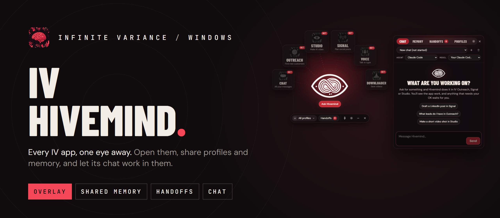
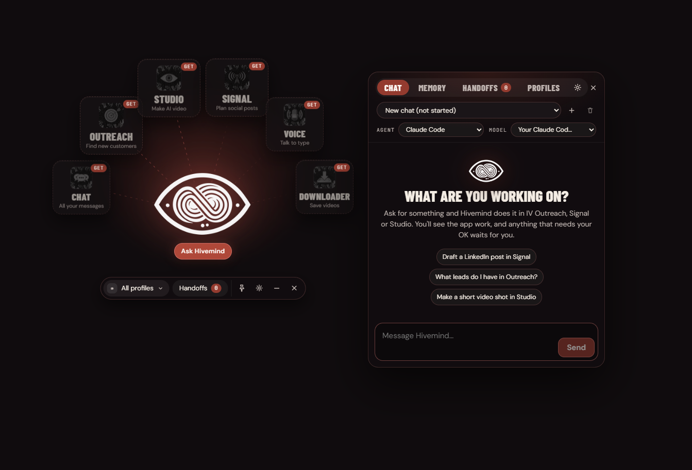
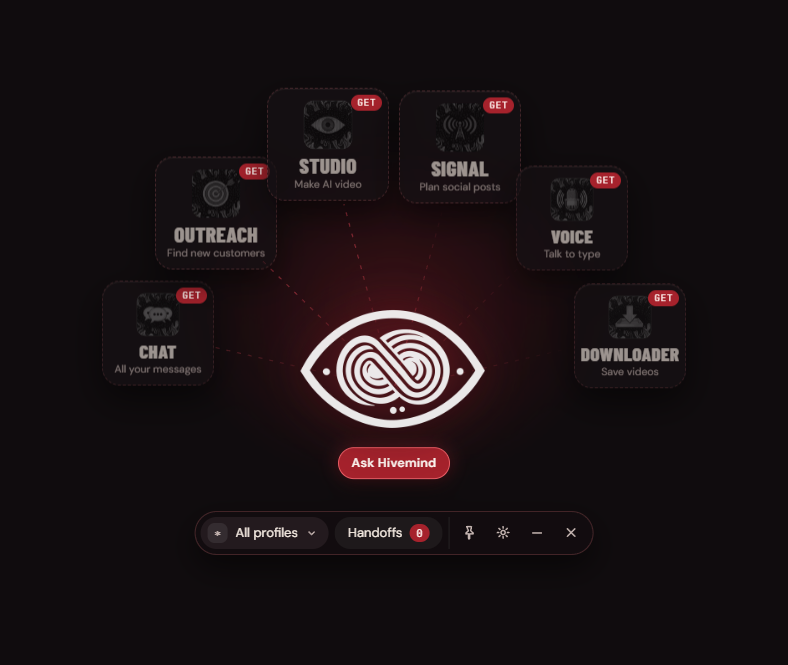

  

  <a href="https://github.com/hollisorg/iv-hivemind-releases/releases/latest/download/IV-Hivemind-Setup.exe"><b>Download for Windows</b></a>
  &nbsp;·&nbsp;
  <a href="https://github.com/hollisorg/iv-outreach#iv-hivemind">Source</a>
  &nbsp;·&nbsp;
  <a href="https://infinitevariance.ai">Infinite Variance</a>

# IV Hivemind

Installers and update files for **IV Hivemind**, Infinite Variance's desktop overlay for the IV apps
(IV Studio, IV Signal, IV Outreach, IV Chat, IV Voice and IV Downloader).

  

## What it does

- **Every IV app around one eye.** Hivemind floats over your desktop. Click an app to open it, or **Get**
  to install it: Hivemind downloads the installer from that app's own GitHub releases and checks it before it
  runs.
- **Profiles that travel.** Your business profiles (name, website, offer, audience, voice, look) are shared
  with IV Outreach, IV Signal and IV Studio, so each app starts from the same brand.
- **Shared memory.** IV memory keeps short facts about you and your business, saved from Hivemind's chat,
  for the IV apps' chats to read.
- **Handoffs.** A content brief from IV Outreach becomes a project in IV Studio, and the finished picture or
  video becomes an unapproved post draft in IV Signal. Hivemind keeps the list, and nothing is approved or
  published for you.
- **A chat that works in your apps.** Ask Hivemind for something ("draft a LinkedIn post in Signal", "what
  leads do I have in Outreach?", "make a short video shot in Studio") and it does it in the app through your
  own Claude Code or Codex. You see the app work, and anything that needs your OK waits for you.
- **Out of the way.** Empty space lets the mouse straight through to whatever is behind it. Keep it on top,
  minimise it, or close it.

  

## Install

1. [Download `IV-Hivemind-Setup.exe`](https://github.com/hollisorg/iv-hivemind-releases/releases/latest/download/IV-Hivemind-Setup.exe)
   (Windows 10 or 11, 64-bit, about 110 MB).
2. Run it. The installer isn't code-signed yet, so Windows may show **"Windows protected your PC"**: choose
   **More info → Run anyway**.

The app downloads its updates from here by itself; the gear button shows its version.

This repository holds releases only. The source code is in
[hollisorg/iv-outreach](https://github.com/hollisorg/iv-outreach), in `apps/hivemind`.
